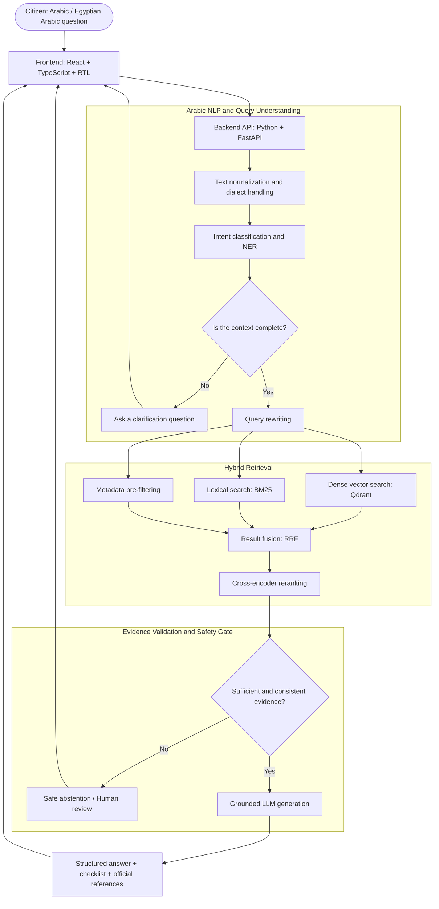

<div align="center">

# ⚖️ HAQI | حقي

### المساعد الذكي للخدمات الحكومية والحقوق العامة

**An Arabic-First CivicTech Assistant for Government Services & Public Rights**

<p dir="rtl">
اعرف حقك، افهم الإجراءات، وخد خطوتك الجاية بثقة.
</p>

*Know Your Rights. Understand the Process. Take Your Next Step with Confidence.*

[](#project-status)
[](#overview)
[](#technology-stack)
[](#system-architecture)
[](LICENSE)

[🌐 Live Prototype](https://id-preview--793892ff-e93e-447c-8617-5e5961150442.lovable.app) · [🏗️ Architecture](#system-architecture) · [🧰 Tech Stack](#technology-stack) · [🚀 Setup](#getting-started)

</div>

---

<a id="overview"></a>
## 📌 Overview | نظرة عامة

<div dir="rtl" align="right">

**حقي (HAQI)** هو مشروع تكنولوجيا مدنية (CivicTech) يوظّف الذكاء الاصطناعي ومعالجة اللغة الطبيعية العربية لتسهيل وصول المواطنين إلى المعلومات الإجرائية المتعلقة بالخدمات الحكومية والحقوق العامة.

يركّز المشروع على تقديم معلومات مستندة إلى الوثائق والمصادر الرسمية المنشورة، مع توضيح مصدر المعلومة والخطوات التالية بدلًا من تقديم إجابات عامة غير موثقة.

</div>

The system is designed around three principles:

| Principle | Description |
|---|---|
| **Understand** | Understand Modern Standard Arabic and Egyptian Arabic, identify the user's intent, and ask follow-up questions when essential context is missing. |
| **Verify** | Retrieve supporting passages using hybrid search, rerank the results, and abstain when the available evidence is insufficient or conflicting. |
| **Guide** | Turn complex procedures into clear steps, document checklists, and links to the relevant official sources. |

<a id="project-status"></a>
## 🚦 Project Status | حالة المشروع

> **Current stage: Frontend prototype. The complete AI-backed service is not yet presented as production-ready.**

| Component | Current status | Notes |
|---|---|---|
| Arabic RTL frontend | 🟢 Prototype available | A live interface prototype is available for review. |
| Chat responses | 🟡 Simulated | The current demo uses illustrative responses; it is not connected to live government data. |
| Backend API | 🔧 MVP scope | FastAPI is part of the target architecture. |
| Knowledge base & RAG | 🔧 MVP scope | Official-document ingestion, PostgreSQL, Qdrant, hybrid retrieval, and evidence validation are within the planned MVP scope. |

<div dir="rtl" align="right">

**جرّب النموذج الأولي:** [فتح واجهة حقي على Lovable](https://id-preview--793892ff-e93e-447c-8617-5e5961150442.lovable.app)

الرابط يعرض تجربة الواجهة العربية واتجاه الكتابة من اليمين إلى اليسار (RTL). المحادثة في النسخة الحالية تجريبية، ولا تتصل بقاعدة بيانات حكومية أو بمحرك RAG فعلي.

</div>

### ⚠️ Important Disclaimer | إخلاء مسؤولية

<div dir="rtl" align="right">

- الأمثلة الإجرائية والرسوم والمدد الزمنية المعروضة في النموذج الأولي هي **محتوى توضيحي غير متحقق منه قانونيًا**.
- يهدف المشروع إلى تقديم إرشاد إجرائي عام، ولا يُعد جهة حكومية أو بديلًا عن الاستشارة القانونية.
- يجب الرجوع إلى الجهة الحكومية المختصة والمصادر الرسمية للتحقق من أحدث المتطلبات والرسوم والمواعيد قبل اتخاذ أي إجراء.

</div>

## ✨ Core Capabilities | الوظائف المستهدفة

The following capabilities describe the intended system design; they should not be interpreted as a statement that every feature is already implemented.

- **Arabic query understanding:** Handle Arabic and Egyptian dialect input, normalize text, and classify user intent.
- **Clarification:** Ask focused follow-up questions when the user's request lacks necessary details.
- **Hybrid evidence retrieval:** Combine semantic vector search with BM25 lexical search.
- **Reranking:** Reorder retrieved passages with a cross-encoder to improve evidence relevance.
- **Evidence-grounded answers:** Generate structured responses from retrieved official material and attach source references.
- **Safe abstention:** Avoid making unsupported claims when evidence is missing, outdated, or contradictory.
- **Practical guidance:** Present ordered steps and document checklists where the source material supports them.

<a id="system-architecture"></a>
## 🏗️ System Architecture | المعمارية التقنية

The proposed request flow is illustrated below:



## 🗂️ Repository Structure | هيكل المستودع

The repository is intended to separate the frontend, backend, document-processing pipeline, and evaluation assets.

```text
haqi-civictech-ai/
├── README.md
├── LICENSE
├── .gitignore
├── .env.example
├── docker-compose.yml
│
├── docs/
│   ├── HAQI_Full_Documentation.pdf
│   ├── HAQI_Presentation_Slides.pdf
│   └── architecture/
│
├── frontend/
│   ├── package.json
│   ├── tsconfig.json
│   └── src/
│       ├── components/
│       ├── pages/
│       └── styles/
│
├── backend/
│   ├── requirements.txt
│   └── app/
│       ├── main.py
│       ├── core/
│       ├── schemas/
│       ├── nlp/
│       ├── retrieval/
│       ├── validation/
│       └── api/
│
├── data_pipeline/
│   ├── extractors/
│   ├── chunking/
│   └── seed_sample/
│
└── evaluation/
    ├── benchmark_dataset_schema.json
    └── metrics/
```

<div dir="rtl" align="right">

> **ملاحظة:** الهيكل أعلاه هو الهيكل المستهدف/الموصوف للمشروع. قد تختلف الملفات الموجودة فعليًا في المستودع حسب مرحلة التطوير الحالية.

</div>

<a id="technology-stack"></a>
## 🧰 Technology Stack | الحزمة التقنية

| Layer | Technology | Intended role |
|---|---|---|
| Frontend | React, TypeScript, Tailwind CSS | Responsive Arabic RTL user interface. |
| Backend API | Python 3.11+, FastAPI, Pydantic | API endpoints, request handling, and data validation. |
| Arabic NLP & AI | Transformers, Arabic sentence embeddings, LLM APIs | Text normalization, intent classification, query rewriting, and grounded generation. |
| Vector retrieval | Qdrant | Dense semantic retrieval over document chunks. |
| Lexical retrieval | BM25 | Keyword-based retrieval to complement semantic search. |
| Reranking | Cross-Encoder | Relevance reranking of retrieved passages. |
| Relational database | PostgreSQL | Store source records, service information, citations, and review records. |
| Document processing | PyMuPDF, OCR tools, custom Arabic chunking | Extract, clean, split, and enrich official documents. |
| Local services | Docker Compose | Run supporting services locally during development. |

## 📚 Official Source Metadata | البيانات الوصفية للمصادر

<div dir="rtl" align="right">

لضمان إمكانية تتبع كل معلومة إلى أصلها، يستهدف تصميم قاعدة المعرفة ربط كل مقطع نصي (Chunk) بالحقول الوصفية الثمانية التالية:

</div>

| Field | Purpose |
|---|---|
| `document_title` | Title of the official document or guide. |
| `government_authority` | Government authority that issued the document. |
| `original_url` | Original URL on the official portal. |
| `publication_date` | Official publication date. |
| `last_updated_date` | Date of the latest published update, when available. |
| `service_category` | Service category, such as `civil_status`. |
| `last_verification_date` | Date the project team last checked the source. |
| `document_version` | Document version used for change tracking. |

<a id="getting-started"></a>
## 🚀 Getting Started | التشغيل المحلي

### Prerequisites | المتطلبات

- Python **3.11 or later**
- Node.js **18 or later** and npm
- Docker Engine / Docker Desktop with Docker Compose
- Git

### 1. Clone the repository

Replace `<YOUR_GITHUB_USERNAME>` with the account or organization that hosts the repository.

```bash
git clone https://github.com/<YOUR_GITHUB_USERNAME>/haqi-civictech-ai.git
cd haqi-civictech-ai
```

### 2. Configure environment variables

If the repository includes `.env.example`, create your local environment file and fill in the required values:

```bash
cp .env.example .env
```

On Windows PowerShell:

```powershell
Copy-Item .env.example .env
```

**Never commit `.env` or real API keys, passwords, database credentials, or tokens.**

### 3. Start supporting services

Run this from the repository root, provided the Compose file defines services named `postgres` and `qdrant`:

```bash
docker compose up -d postgres qdrant
```

### 4. Set up the backend

```bash
cd backend
python -m venv .venv
```

Activate the environment:

```bash
# macOS / Linux
source .venv/bin/activate

# Windows PowerShell
.venv\Scripts\Activate.ps1
```

Install dependencies and start the API:

```bash
pip install -r requirements.txt
uvicorn app.main:app --reload --port 8000
```

When the API is running, open the interactive documentation at:

[http://localhost:8000/docs](http://localhost:8000/docs)

### 5. Set up the frontend

Open a second terminal from the repository root:

```bash
cd frontend
npm install
npm run dev
```

Use the local URL printed by the frontend development server.

> These commands assume the corresponding backend, frontend, dependency files, and Docker Compose services are present and configured in the checked-out repository.

## 📊 Evaluation Methodology | منهجية التقييم

<div dir="rtl" align="right">

يستهدف تقييم النظام مجموعة بيانات عربية مرجعية تتم مراجعتها يدويًا، مع قياس الجودة عبر أربعة محاور:

</div>

| Evaluation area | Metrics |
|---|---|
| Retrieval quality | `Recall@K`, `MRR`, `nDCG` |
| Answer quality and grounding | `Faithfulness`, `Answer Accuracy`, `Citation Precision` |
| Safety and reliability | `Abstention Quality`, `Unsupported Claim Rate` |
| Performance | `Retrieval Time`, `End-to-End Response Latency` |

## 🔐 Data, Documents & Third-Party Content

HAQI is designed to reference official sources, but the right to reuse or redistribute a source document, dataset, image, or other third-party asset depends on that material's own terms. The repository's software license does not automatically relicense external content.

<div dir="rtl" align="right">

يجب التأكد من شروط استخدام وإعادة نشر أي وثائق أو بيانات أو صور أو مواد تابعة لجهات خارجية قبل إضافتها إلى المستودع. وجود رابط لمصدر حكومي لا يعني تلقائيًا أن جميع محتوياته متاحة لإعادة النشر تحت رخصة المشروع.

</div>

## 📄 License | الترخيص

The HAQI source code is licensed under the **MIT License**. See [`LICENSE`](LICENSE) for the full text. Third-party documents, datasets, assets, and trademarks may be subject to separate terms.

---

<div align="center">

**«حقي لا يكتفي بالإجابة؛ بل يوضح للمواطن الطريق، ويُريه الدليل.»**

*HAQI — Clear steps. Traceable evidence.*

</div>
